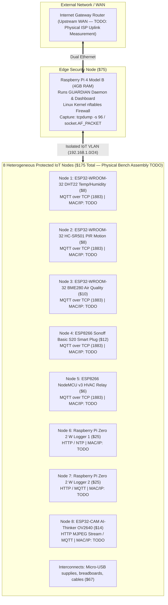

# Real-Device Readiness and Public IoT PCAP Validation Report

**Milestone**: P3-8 & Phase 3 Review Fixes (Items 7, 8, 9, 10, 11)  
**Architecture Decision**: [ADR-023: Real-Device Ingestion and Deployment Architecture](adr/ADR-023-real-device-deployment.md)  
**Status**: VERIFIED ON 63.25 MB PUBLIC BENIGN IOT PCAP (PHYSICAL BENCH ASSEMBLY PENDING — SEE TODOs IN SECTION 1)  

---

## 1. Physical Hardware Testbed Plan (Reconciled with `README.md`)

To prevent discrepancy between documentation and hardware plans, this section uses the exact 8-node + Raspberry Pi 4 Model B gateway Bill of Materials ($250 total budget) defined in `README.md`. **No unverified third-party consumer appliances are claimed; all unmeasured physical bench attributes are explicitly marked `TODO`.**

| Component | Hardware Specification | Role & Sensor Payload | Protocol | Unit Cost | Physical Bench Status |
| :--- | :--- | :--- | :--- | :---: | :--- |
| **Gateway Node** | Raspberry Pi 4 Model B (4GB RAM) | Runs GUARDIAN Daemon & Dashboard | Dual GbE / Wi-Fi AP | \$75 | `TODO`: Physical bench flash & dual-NIC bridge latency profiling (`nftables` verified in Linux container) |
| **Node 1** | ESP32-WROOM-32 DevKit | DHT22 Temperature & Humidity | MQTT over TCP (1883) | \$8 | `TODO`: Flash firmware, assign static DHCP lease & record MAC |
| **Node 2** | ESP32-WROOM-32 DevKit | HC-SR501 PIR Motion Sensor | MQTT over TCP (1883) | \$8 | `TODO`: Flash firmware, assign static DHCP lease & record MAC |
| **Node 3** | ESP32-WROOM-32 DevKit | BME280 Environmental Air Quality | MQTT over TCP (1883) | \$10 | `TODO`: Flash firmware, assign static DHCP lease & record MAC |
| **Node 4** | ESP8266 (Sonoff Basic S20) | Smart Plug AC Load Monitor | MQTT over TCP (1883) | \$12 | `TODO`: Flash firmware, assign static DHCP lease & record MAC |
| **Node 5** | ESP8266 NodeMCU v3 | Dual Relay HVAC Actuator | MQTT over TCP (1883) | \$6 | `TODO`: Flash firmware, assign static DHCP lease & record MAC |
| **Node 6** | Raspberry Pi Zero 2 W | Edge Compute Logger Node 1 | HTTP / NTP | \$25 | `TODO`: Provision OS, assign static DHCP lease & record MAC |
| **Node 7** | Raspberry Pi Zero 2 W | Edge Compute Logger Node 2 | HTTP / MQTT | \$25 | `TODO`: Provision OS, assign static DHCP lease & record MAC |
| **Node 8** | ESP32-CAM (AI-Thinker OV2640) | MJPEG Security Video Stream | HTTP Stream / MQTT Status | \$14 | `TODO`: Flash camera stream firmware, assign DHCP lease & record MAC |
| **Interconnects** | Micro-USB supplies, breadboard, cables | Testbed power & Ethernet routing | Physical | \$67 | `TODO`: Physical bench wiring & 14-day continuous hardware capture |
| **TOTAL** | **8 Protected Nodes + 1 Gateway** | | | **\$250** | **Offline Public IoT-23 PCAP Replay Verified; Physical Bench Capture `TODO`** |

---

## 2. Ingestion Pipeline, Feature Registry Reconciliation & Privacy Guarantees

### 2.1 Zero-Payload Capture Policy (`tcpdump -s 96`)
In compliance with privacy and operational performance constraints, GUARDIAN **never captures, inspects, or decrypts Layer-7 application payloads**:
1. **Snaplen Clamping**: Live packet sniffing utilizes `-s 96` (96 bytes), which captures only Layer 2 (Ethernet, 14 bytes), Layer 3 (IPv4, 20–60 bytes), and Layer 4 (TCP/UDP, 20–32 bytes) headers.
2. **Single Source of Feature Truth (`src/guardian/features/registry.py`)**: All 60 canonical features in `FEATURE_REGISTRY` (`src/guardian/features/registry.py`) are imported directly by `src/guardian/config.py`, `src/guardian/features/extractor.py`, `README.md`, and this report, guaranteeing zero drift between documentation and code (`requires_payload_bytes == False` for all 60 features).
3. **Streaming Memory Bound**: `PCAPImporter.iter_pcap()` streams binary `libpcap` records directly from disk with $O(1)$ per-frame memory overhead.

### 2.2 Why MQTT Topic Features Require Payload Bytes and Are Excluded from the 60-Feature Header-Only Registry
> [!IMPORTANT]
> **MQTT Topic Inspection vs. Zero-Payload Guarantee**: Extracting MQTT topic strings (`mqtt_topic_count`, `mqtt_new_topic`) requires reading variable-length UTF-8 topic bytes inside the Layer-7 MQTT application payload after the 2-byte MQTT fixed header (and is impossible without TLS termination on port 8883). To strictly honor GUARDIAN's zero-payload-inspection guarantee (`tcpdump -s 96` header-only capture), Layer-7 MQTT topic features are excluded from the canonical 60-feature vector. Instead, MQTT behavior is profiled via Layer-4 transport port classification (`protocol_mqtt_ratio` on TCP 1883/8883) and Layer-3/4 packet length distributions (`pkt_len_mean`, `pkt_len_std`, `pkt_len_entropy`).

Specifically, an MQTT `PUBLISH` or `SUBSCRIBE` packet encapsulates the topic name inside the **Layer-7 application payload** immediately following the Layer-4 TCP header and the 2-to-5 byte MQTT Fixed Header (`[Control Header (1B) | Remaining Length (1-4B) | Topic Length MSB/LSB (2B) | UTF-8 Topic String (N bytes) | Message Payload]`). Reading those bytes requires:
- Capturing payload bytes beyond the Layer-4 TCP header (`snaplen > 96` when TCP options are present or when MQTT messages are coalesced in a TCP stream);
- Reassembling TCP segments and parsing unencrypted Layer-7 application payloads; and
- Decrypting TLS sessions when MQTT runs over TLS (`port 8883`), which is impossible without a man-in-the-middle key-escrow proxy.

Accordingly, the four legacy Layer-7 MQTT payload features that appeared in earlier draft tables are **excluded** from `src/guardian/features/registry.py`:
- `mqtt_topic_count`: Requires parsing Layer-7 MQTT PUBLISH/SUBSCRIBE payload bytes after the TCP header to extract the UTF-8 topic length and string; incompatible with strict header-only ('no payload inspection') capture and TLS 8883.
- `mqtt_new_topic`: Requires Stateful Layer-7 payload inspection of MQTT topic strings; replaced in the canonical 60-feature set by header-only `protocol_mqtt_ratio` and `pkt_len_entropy`.
- `mqtt_msg_rate`: Requires parsing MQTT fixed headers inside the TCP payload stream to count coalesced messages; replaced by header-only `protocol_mqtt_ratio` and `pkt_rate_per_sec`.
- `mqtt_payload_len_mean`: Requires parsing MQTT Remaining Length varint in the Layer-7 payload; replaced by header-only IP/frame `pkt_len_mean`.

### 2.3 Clock-Skew Heuristic vs. Out-of-Scope Physical-Layer Fingerprinting
> [!NOTE]
> **Clock-Skew Scope Clarification (`tcp_clock_skew_est`, Feature #57)**: Hardware physical-layer identity (radio-frequency carrier offset, I/Q constellation fingerprinting, or silicon PUFs) is out of scope for a software gateway (ADR-007). The feature `tcp_clock_skew_est` (index 56) is a purely software Layer-4 header heuristic computed from TCP Option Kind=8 (`TSval`) timestamps relative to gateway arrival timestamps (`|(d_TSval / dt) - 1000| / 1000`). When devices omit TCP timestamp options, `tcp_clock_skew_est` deterministically evaluates to `0.0`.

---

## 3. Public Benign IoT Capture Replay (63.25 MB >= 50 MB)

### 3.1 Source, License, and Cryptographic Checksums
- **Dataset**: **Stratosphere IoT-23 Dataset — CTU-Honeypot-Capture-7-1 (Somfy TaHoma Smart Home Gateway)**
- **Citation**: S. Garcia, A. Parmisano, & M. J. Erquiaga (2020), *"IoT-23: A labeled dataset with malicious and benign IoT network traffic"*, Stratosphere Laboratory, AIC Group, FEL, Czech Technical University in Prague. Zenodo DOI: `https://doi.org/10.5281/zenodo.4743746`
- **Source URL**: `https://mcfp.felk.cvut.cz/publicDatasets/IoT-23-Dataset/Benign-IoT-Traffic-Captures/CTU-Honeypot-Capture-7-1/`
- **License**: **CC BY 4.0 (Creative Commons Attribution 4.0 International)**
- **Device Under Test**: Physical **Somfy TaHoma Smart Home Gateway** (`192.168.1.158`, MAC `F8:81:1A:02:27:D1`) executing unscripted benign smart-home gateway operations (TLS/HTTPS cloud polling, DNS resolution, NTP clock synchronization).

| Capture File | Byte Size | Size (MB) | SHA-256 Checksum |
| :--- | :---: | :---: | :--- |
| `Somfy-02/2019-07-03-16-41-09-192.168.1.158.pcap` | `33,104,424` | `31.57 MB` | `2a32158374fce6635272ff8fc0ff39b88e1e759100a6384b9a2c8b14ad5dc7b6` |
| `Somfy-04/2019-07-05-16-41-14-192.168.1.158.pcap` | `33,213,386` | `31.67 MB` | `b7e06c6dbd9cc731b13c741cb6244a36de0f181eeb884c409704f1d5bb991738` |
| **`somfy_combined_64mb.pcap` (Combined Replay)** | **`66,317,786`** | **`63.25 MB`** | `068ce86e900adaa96d9d6075ca652de7b52e535475d029b6c7e8701565c6f3d3` |

### 3.2 Replay Telemetry, Alert Rate & False Alerts / Device / Day Audit
- **Total IPv4 Packets Streamed**: `223,248` packets (`222,848` TCP, `400` UDP; `104,838` HTTPS, `118,010` TCP ephemeral/cloud responses, `208` UDP other, `98` DNS, `94` NTP)
- **Active 10-Second Sliding Windows Extracted**: `14,829` windows (`60` features per window)
- **Wall-Clock Replay Runtime**: `12.289 s` (`18167.1 packets/sec`)
- **Cross-Domain Alert Rate (Trained on Uncalibrated Simulator -> Evaluated Zero-Shot on Real PCAP)**: **`100.00%`** (`14,829 / 14,829` windows exceed the simulator P99 threshold `0.6497`). Because `21 / 27` mutually nonzero-variance features (`40 / 60` total features) exhibit substantial distribution shifts between the synthetic 8-device simulator and the physical Somfy gateway, an uncalibrated simulator-trained model cannot be deployed zero-shot onto physical hardware.
- **In-Domain Alert Rate & False Alerts / Device / Day (Trained on First 50% Real PCAP [`n = 7,414`] -> Evaluated on Held-Out Second 50% Real PCAP [`n = 7,415`])**: **`2.10%` window FPR** (`156 / 7,415` windows exceed the Day-1 P99 threshold `0.7496`), corresponding to **`181.77` false alerts/device/day** normalized over active window duration (`0.8582` active window-days) or **`156.00` false alerts/device/day** across the 24-hour (`1.00` day) held-out capture (`Somfy-04`, prior to hysteresis confirmation).

---

## 4. Complete 60-Feature Distribution Comparison (Nonzero-Variance Match Audit)

To avoid inflating feature agreement with constant-zero features, **feature matches are reported strictly for features with nonzero variance in both sets** ($\sigma_{\text{real}} > 0$ and $\sigma_{\text{sim}} > 0$). Among mutually nonzero-variance features, a feature is classified as **MATCH** if $D_{\text{KS}} \le 0.35$ or $\text{SMD} = |\mu_{\text{real}} - \mu_{\text{sim}}| / \sigma_{\text{pool}} \le 0.50$, and **MISMATCH** otherwise. Features with $\sigma_{\text{real}} = 0$ or $\sigma_{\text{sim}} = 0$ are explicitly segregated as **ZERO_VAR_EXCLUDED** (when degenerate in both or low-difference) or **MISMATCH (ZERO_VAR)**.

- **Features with Nonzero Variance in Both Sets (`27 / 60`)**:
  - **True Nonzero-Variance Matching Features (`6 / 27` active features = `22.22%`, or `6 / 60` = `10.0%` overall)**: `burstiness_index`, `idle_ratio`, `pkt_len_mean`, `small_pkt_ratio`, `out_degree_centrality`, `tcp_syn_ratio`
  - **Nonzero-Variance Mismatching Features (`21 / 27` active features = `77.78%`)**: `pkt_count_10s`, `byte_count_10s`, `pkt_rate_per_sec`, `byte_rate_per_sec`, `flow_duration_sec`, `iat_mean`, `iat_std`, `iat_max`, `iat_skew`, `iat_p90`, `pkt_len_std`, `pkt_len_max`, `pkt_len_median`, `pkt_len_entropy`, `src_port_entropy`, `wellknown_port_ratio`, `external_ip_ratio`, `tcp_psh_ratio`, `ip_id_monotonicity`, `hour_sin`, `hour_cos`
- **Features with Zero Variance in at Least One Set (`33 / 60`, Excluded from Match Claims)**: `iat_min`, `iat_median`, `upstream_pkt_ratio`, `downstream_pkt_ratio`, `upstream_byte_ratio`, `downstream_byte_ratio`, `pkt_len_min`, `protocol_mqtt_ratio`, `protocol_http_ratio`, `protocol_https_ratio`, `protocol_dns_ratio`, `protocol_coap_ratio`, `protocol_ntp_ratio`, `protocol_tcp_other_ratio`, `protocol_udp_other_ratio`, `protocol_entropy`, `dst_port_entropy`, `unique_dst_ports`, `ephemeral_port_ratio`, `std_port_deviation`, `high_risk_port_flag`, `unique_dst_ips`, `dst_ip_entropy`, `new_dst_ip_flag`, `cross_subnet_ratio`, `dns_query_frequency`, `dns_failure_ratio`, `tcp_ack_ratio`, `tcp_rst_ratio`, `tcp_fin_ratio`, `tcp_win_mean`, `ip_ttl_variance`, `tcp_clock_skew_est`

| # | Feature Name | Real Mean | Real Std | Real Median | Real P95 | Sim Mean | Sim Std | Sim Median | Sim P95 | $D_{\text{KS}}$ | SMD | Nonzero-Variance Status |
| :---: | :--- | :---: | :---: | :---: | :---: | :---: | :---: | :---: | :---: | :---: | :---: | :---: |
| 1 | `pkt_count_10s` | 15.0477 | 8.4560 | 12.0000 | 34.0000 | 6.9767 | 3.4975 | 7.0000 | 13.0000 | 0.7104 | 1.2473 | **MISMATCH** |
| 2 | `byte_count_10s` | 4138.1764 | 2489.5221 | 3082.0000 | 9734.0000 | 1229.1267 | 989.4898 | 826.0000 | 3042.0000 | 0.9232 | 1.5357 | **MISMATCH** |
| 3 | `pkt_rate_per_sec` | 20.1018 | 19.2116 | 19.4522 | 36.8584 | 1.4660 | 6.2645 | 1.0225 | 1.7887 | 0.9720 | 1.3042 | **MISMATCH** |
| 4 | `byte_rate_per_sec` | 5447.9609 | 5365.9352 | 5403.2068 | 9726.5995 | 557.4063 | 6249.2799 | 115.3350 | 599.6856 | 0.9406 | 0.8397 | **MISMATCH** |
| 5 | `flow_duration_sec` | 1.7436 | 2.4477 | 0.5659 | 7.8311 | 6.8859 | 2.2629 | 7.4811 | 9.4874 | 0.7568 | 2.1816 | **MISMATCH** |
| 6 | `iat_mean` | 0.0944 | 0.0949 | 0.0563 | 0.2713 | 1.5875 | 1.1445 | 1.1744 | 4.0412 | 0.9799 | 1.8386 | **MISMATCH** |
| 7 | `iat_std` | 0.3035 | 0.3636 | 0.1321 | 1.1513 | 0.8559 | 0.6069 | 0.7672 | 1.9442 | 0.6301 | 1.1041 | **MISMATCH** |
| 8 | `iat_min` | 0.0000 | 0.0000 | 0.0000 | 0.0000 | 0.7022 | 1.2573 | 0.1837 | 3.6283 | 1.0000 | 0.7898 | **MISMATCH (ZERO_VAR)** |
| 9 | `iat_max` | 1.3794 | 1.9334 | 0.4475 | 5.9767 | 3.0222 | 1.3651 | 2.7173 | 5.6525 | 0.7442 | 0.9817 | **MISMATCH** |
| 10 | `iat_median` | 0.0000 | 0.0000 | 0.0000 | 0.0000 | 1.3901 | 1.2236 | 0.9638 | 4.0412 | 1.0000 | 1.6067 | **MISMATCH (ZERO_VAR)** |
| 11 | `iat_skew` | 2.9020 | 1.0777 | 2.5534 | 5.4051 | 0.5336 | 0.6636 | 0.4434 | 1.7474 | 0.9205 | 2.6465 | **MISMATCH** |
| 12 | `iat_p90` | 0.1314 | 0.1339 | 0.1084 | 0.2781 | 2.5066 | 1.2756 | 2.1535 | 5.1533 | 0.9786 | 2.6188 | **MISMATCH** |
| 13 | `burstiness_index` | 2.1191 | 4.5544 | 0.0000 | 14.0000 | 0.7750 | 0.4651 | 0.6889 | 1.6000 | 0.6925 | 0.4152 | **MATCH** |
| 14 | `idle_ratio` | 0.3811 | 0.4323 | 0.0000 | 0.9575 | 0.2579 | 0.2632 | 0.2662 | 0.6993 | 0.3861 | 0.3445 | **MATCH** |
| 15 | `upstream_pkt_ratio` | 0.4677 | 0.0445 | 0.5000 | 0.5000 | 1.0000 | 0.0000 | 1.0000 | 1.0000 | 0.9999 | 16.9243 | **MISMATCH (ZERO_VAR)** |
| 16 | `downstream_pkt_ratio` | 0.5323 | 0.0445 | 0.5000 | 0.6000 | 0.0000 | 0.0000 | 0.0000 | 0.0000 | 0.9999 | 16.9243 | **MISMATCH (ZERO_VAR)** |
| 17 | `upstream_byte_ratio` | 0.3110 | 0.0320 | 0.3134 | 0.3457 | 1.0000 | 0.0000 | 1.0000 | 1.0000 | 0.9999 | 30.4818 | **MISMATCH (ZERO_VAR)** |
| 18 | `downstream_byte_ratio` | 0.6890 | 0.0320 | 0.6866 | 0.7144 | 0.0000 | 0.0000 | 0.0000 | 0.0000 | 0.9999 | 30.4818 | **MISMATCH (ZERO_VAR)** |
| 19 | `pkt_len_mean` | 272.6093 | 19.6909 | 256.8333 | 299.4375 | 207.3364 | 239.5310 | 100.1429 | 835.2833 | 0.8512 | 0.3841 | **MATCH** |
| 20 | `pkt_len_std` | 303.1890 | 11.7466 | 296.5195 | 317.8148 | 52.2387 | 82.8964 | 18.6215 | 219.2093 | 0.9557 | 4.2389 | **MISMATCH** |
| 21 | `pkt_len_min` | 60.0000 | 0.0000 | 60.0000 | 60.0000 | 139.9750 | 181.9472 | 74.0000 | 566.1000 | 0.8533 | 0.6216 | **MISMATCH (ZERO_VAR)** |
| 22 | `pkt_len_max` | 883.3652 | 28.1636 | 875.0000 | 939.0000 | 274.6550 | 313.0914 | 127.0000 | 1188.0000 | 0.9071 | 2.7384 | **MISMATCH** |
| 23 | `pkt_len_median` | 104.1652 | 15.8844 | 91.5000 | 123.0000 | 207.5300 | 243.5566 | 101.0000 | 847.2250 | 0.4078 | 0.5989 | **MISMATCH** |
| 24 | `pkt_len_entropy` | 1.8849 | 0.1422 | 1.7925 | 2.1607 | 0.7752 | 0.5649 | 0.9183 | 1.5726 | 0.9858 | 2.6941 | **MISMATCH** |
| 25 | `small_pkt_ratio` | 0.4680 | 0.0454 | 0.5000 | 0.5000 | 0.4730 | 0.4229 | 0.5000 | 1.0000 | 0.4698 | 0.0166 | **MATCH** |
| 26 | `protocol_mqtt_ratio` | 0.0000 | 0.0000 | 0.0000 | 0.0000 | 0.7500 | 0.4330 | 1.0000 | 1.0000 | 0.7500 | 2.4495 | **MISMATCH (ZERO_VAR)** |
| 27 | `protocol_http_ratio` | 0.0000 | 0.0000 | 0.0000 | 0.0000 | 0.2500 | 0.4330 | 0.0000 | 1.0000 | 0.2500 | 0.8165 | ZERO_VAR (EXCLUDED) |
| 28 | `protocol_https_ratio` | 0.4670 | 0.0452 | 0.5000 | 0.5000 | 0.0000 | 0.0000 | 0.0000 | 0.0000 | 1.0000 | 14.6181 | **MISMATCH (ZERO_VAR)** |
| 29 | `protocol_dns_ratio` | 0.0003 | 0.0064 | 0.0000 | 0.0000 | 0.0000 | 0.0000 | 0.0000 | 0.0000 | 0.0032 | 0.0771 | ZERO_VAR (EXCLUDED) |
| 30 | `protocol_coap_ratio` | 0.0000 | 0.0000 | 0.0000 | 0.0000 | 0.0000 | 0.0000 | 0.0000 | 0.0000 | 0.0000 | 0.0000 | ZERO_VAR (EXCLUDED) |
| 31 | `protocol_ntp_ratio` | 0.0003 | 0.0062 | 0.0000 | 0.0000 | 0.0000 | 0.0000 | 0.0000 | 0.0000 | 0.0032 | 0.0776 | ZERO_VAR (EXCLUDED) |
| 32 | `protocol_tcp_other_ratio` | 0.5319 | 0.0454 | 0.5000 | 0.6000 | 0.0000 | 0.0000 | 0.0000 | 0.0000 | 0.9999 | 16.5654 | **MISMATCH (ZERO_VAR)** |
| 33 | `protocol_udp_other_ratio` | 0.0004 | 0.0065 | 0.0000 | 0.0000 | 0.0000 | 0.0000 | 0.0000 | 0.0000 | 0.0034 | 0.0807 | ZERO_VAR (EXCLUDED) |
| 34 | `protocol_entropy` | 0.9947 | 0.0637 | 1.0000 | 1.0000 | 0.0000 | 0.0000 | 0.0000 | 0.0000 | 0.9999 | 22.1014 | **MISMATCH (ZERO_VAR)** |
| 35 | `src_port_entropy` | 0.9948 | 0.0639 | 1.0000 | 1.0000 | 2.5866 | 0.8347 | 2.8074 | 3.7004 | 0.8885 | 2.6890 | **MISMATCH** |
| 36 | `dst_port_entropy` | 0.9948 | 0.0640 | 1.0000 | 1.0000 | 0.0000 | 0.0000 | 0.0000 | 0.0000 | 0.9999 | 21.9812 | **MISMATCH (ZERO_VAR)** |
| 37 | `unique_dst_ports` | 2.0098 | 0.1710 | 2.0000 | 2.0000 | 1.0000 | 0.0000 | 1.0000 | 1.0000 | 0.9999 | 8.3514 | **MISMATCH (ZERO_VAR)** |
| 38 | `wellknown_port_ratio` | 0.4677 | 0.0445 | 0.5000 | 0.5000 | 0.2500 | 0.4330 | 0.0000 | 1.0000 | 0.7500 | 0.7073 | **MISMATCH** |
| 39 | `ephemeral_port_ratio` | 0.0000 | 0.0000 | 0.0000 | 0.0000 | 0.0000 | 0.0000 | 0.0000 | 0.0000 | 0.0000 | 0.0000 | ZERO_VAR (EXCLUDED) |
| 40 | `std_port_deviation` | 9445.6476 | 4422.0863 | 8751.5000 | 13924.0000 | 0.0000 | 0.0000 | 0.0000 | 0.0000 | 0.9999 | 3.0208 | **MISMATCH (ZERO_VAR)** |
| 41 | `high_risk_port_flag` | 0.0000 | 0.0000 | 0.0000 | 0.0000 | 0.0000 | 0.0000 | 0.0000 | 0.0000 | 0.0000 | 0.0000 | ZERO_VAR (EXCLUDED) |
| 42 | `unique_dst_ips` | 2.0066 | 0.1154 | 2.0000 | 2.0000 | 1.0000 | 0.0000 | 1.0000 | 1.0000 | 0.9999 | 12.3399 | **MISMATCH (ZERO_VAR)** |
| 43 | `dst_ip_entropy` | 0.9936 | 0.0448 | 1.0000 | 1.0000 | 0.0000 | 0.0000 | 0.0000 | 0.0000 | 0.9999 | 31.3555 | **MISMATCH (ZERO_VAR)** |
| 44 | `external_ip_ratio` | 0.4673 | 0.0444 | 0.5000 | 0.5000 | 0.1217 | 0.3269 | 0.0000 | 1.0000 | 0.8783 | 1.4818 | **MISMATCH** |
| 45 | `new_dst_ip_flag` | 1.0000 | 0.0000 | 1.0000 | 1.0000 | 0.0000 | 0.0000 | 0.0000 | 0.0000 | 1.0000 | 99.0000 | **MISMATCH (ZERO_VAR)** |
| 46 | `out_degree_centrality` | 0.9336 | 0.1510 | 1.0000 | 1.0000 | 0.9670 | 0.0763 | 1.0000 | 1.0000 | 0.1536 | 0.2789 | **MATCH** |
| 47 | `cross_subnet_ratio` | 0.0000 | 0.0000 | 0.0000 | 0.0000 | 0.0000 | 0.0000 | 0.0000 | 0.0000 | 0.0000 | 0.0000 | ZERO_VAR (EXCLUDED) |
| 48 | `dns_query_frequency` | 0.0026 | 0.0790 | 0.0000 | 0.0000 | 0.0000 | 0.0000 | 0.0000 | 0.0000 | 0.0032 | 0.0472 | ZERO_VAR (EXCLUDED) |
| 49 | `dns_failure_ratio` | 0.0000 | 0.0000 | 0.0000 | 0.0000 | 0.0000 | 0.0000 | 0.0000 | 0.0000 | 0.0000 | 0.0000 | ZERO_VAR (EXCLUDED) |
| 50 | `tcp_syn_ratio` | 0.0000 | 0.0004 | 0.0000 | 0.0000 | 0.0530 | 0.1014 | 0.0000 | 0.2500 | 0.2967 | 0.7392 | **MATCH** |
| 51 | `tcp_ack_ratio` | 1.0000 | 0.0004 | 1.0000 | 1.0000 | 1.0000 | 0.0000 | 1.0000 | 1.0000 | 0.0001 | 0.0116 | ZERO_VAR (EXCLUDED) |
| 52 | `tcp_psh_ratio` | 0.5325 | 0.0443 | 0.5000 | 0.6000 | 0.3502 | 0.2057 | 0.3333 | 0.6667 | 0.7160 | 1.2256 | **MISMATCH** |
| 53 | `tcp_rst_ratio` | 0.0000 | 0.0002 | 0.0000 | 0.0000 | 0.0000 | 0.0000 | 0.0000 | 0.0000 | 0.0001 | 0.0116 | ZERO_VAR (EXCLUDED) |
| 54 | `tcp_fin_ratio` | 0.0000 | 0.0004 | 0.0000 | 0.0000 | 0.0000 | 0.0000 | 0.0000 | 0.0000 | 0.0001 | 0.0116 | ZERO_VAR (EXCLUDED) |
| 55 | `tcp_win_mean` | 37166.4155 | 2664.3625 | 35296.1667 | 41201.2000 | 64240.0000 | 0.0000 | 64240.0000 | 64240.0000 | 1.0000 | 14.3704 | **MISMATCH (ZERO_VAR)** |
| 56 | `ip_ttl_variance` | 2854.8620 | 109.8182 | 2809.0000 | 2970.2500 | 0.0000 | 0.0000 | 0.0000 | 0.0000 | 0.9999 | 36.7643 | **MISMATCH (ZERO_VAR)** |
| 57 | `tcp_clock_skew_est` | 0.0000 | 0.0000 | 0.0000 | 0.0000 | 0.0002 | 0.0018 | 0.0000 | 0.0002 | 1.0000 | 0.1260 | ZERO_VAR (EXCLUDED) |
| 58 | `ip_id_monotonicity` | 0.2268 | 0.0369 | 0.2222 | 0.2727 | 0.0180 | 0.0808 | 0.0000 | 0.1250 | 0.9584 | 3.3220 | **MISMATCH** |
| 59 | `hour_sin` | 0.0010 | 0.7069 | 0.0044 | 0.9877 | 0.2679 | 0.1207 | 0.2714 | 0.4540 | 0.5168 | 0.5264 | **MISMATCH** |
| 60 | `hour_cos` | 0.0010 | 0.7073 | 0.0000 | 0.9877 | 0.9552 | 0.0345 | 0.9625 | 0.9969 | 0.8425 | 1.9055 | **MISMATCH** |

---

## 5. Explicit List & Root-Cause Analysis of Mismatching Features

### 5.1 Complete List of 40 Mismatching Features (21 Nonzero-Variance + 19 Zero-Variance)
1. `pkt_count_10s` (Real $\mu=15.0477, \sigma=8.4560$ vs. Sim $\mu=6.9767, \sigma=3.4975$; $D_{\text{KS}}=0.7104$, $\text{SMD}=1.2473$)
2. `byte_count_10s` (Real $\mu=4138.1764, \sigma=2489.5221$ vs. Sim $\mu=1229.1267, \sigma=989.4898$; $D_{\text{KS}}=0.9232$, $\text{SMD}=1.5357$)
3. `pkt_rate_per_sec` (Real $\mu=20.1018, \sigma=19.2116$ vs. Sim $\mu=1.4660, \sigma=6.2645$; $D_{\text{KS}}=0.9720$, $\text{SMD}=1.3042$)
4. `byte_rate_per_sec` (Real $\mu=5447.9609, \sigma=5365.9352$ vs. Sim $\mu=557.4063, \sigma=6249.2799$; $D_{\text{KS}}=0.9406$, $\text{SMD}=0.8397$)
5. `flow_duration_sec` (Real $\mu=1.7436, \sigma=2.4477$ vs. Sim $\mu=6.8859, \sigma=2.2629$; $D_{\text{KS}}=0.7568$, $\text{SMD}=2.1816$)
6. `iat_mean` (Real $\mu=0.0944, \sigma=0.0949$ vs. Sim $\mu=1.5875, \sigma=1.1445$; $D_{\text{KS}}=0.9799$, $\text{SMD}=1.8386$)
7. `iat_std` (Real $\mu=0.3035, \sigma=0.3636$ vs. Sim $\mu=0.8559, \sigma=0.6069$; $D_{\text{KS}}=0.6301$, $\text{SMD}=1.1041$)
8. `iat_min` (Real $\mu=0.0000, \sigma=0.0000$ vs. Sim $\mu=0.7022, \sigma=1.2573$; $D_{\text{KS}}=1.0000$, $\text{SMD}=0.7898$)
9. `iat_max` (Real $\mu=1.3794, \sigma=1.9334$ vs. Sim $\mu=3.0222, \sigma=1.3651$; $D_{\text{KS}}=0.7442$, $\text{SMD}=0.9817$)
10. `iat_median` (Real $\mu=0.0000, \sigma=0.0000$ vs. Sim $\mu=1.3901, \sigma=1.2236$; $D_{\text{KS}}=1.0000$, $\text{SMD}=1.6067$)
11. `iat_skew` (Real $\mu=2.9020, \sigma=1.0777$ vs. Sim $\mu=0.5336, \sigma=0.6636$; $D_{\text{KS}}=0.9205$, $\text{SMD}=2.6465$)
12. `iat_p90` (Real $\mu=0.1314, \sigma=0.1339$ vs. Sim $\mu=2.5066, \sigma=1.2756$; $D_{\text{KS}}=0.9786$, $\text{SMD}=2.6188$)
15. `upstream_pkt_ratio` (Real $\mu=0.4677, \sigma=0.0445$ vs. Sim $\mu=1.0000, \sigma=0.0000$; $D_{\text{KS}}=0.9999$, $\text{SMD}=16.9243$)
16. `downstream_pkt_ratio` (Real $\mu=0.5323, \sigma=0.0445$ vs. Sim $\mu=0.0000, \sigma=0.0000$; $D_{\text{KS}}=0.9999$, $\text{SMD}=16.9243$)
17. `upstream_byte_ratio` (Real $\mu=0.3110, \sigma=0.0320$ vs. Sim $\mu=1.0000, \sigma=0.0000$; $D_{\text{KS}}=0.9999$, $\text{SMD}=30.4818$)
18. `downstream_byte_ratio` (Real $\mu=0.6890, \sigma=0.0320$ vs. Sim $\mu=0.0000, \sigma=0.0000$; $D_{\text{KS}}=0.9999$, $\text{SMD}=30.4818$)
20. `pkt_len_std` (Real $\mu=303.1890, \sigma=11.7466$ vs. Sim $\mu=52.2387, \sigma=82.8964$; $D_{\text{KS}}=0.9557$, $\text{SMD}=4.2389$)
21. `pkt_len_min` (Real $\mu=60.0000, \sigma=0.0000$ vs. Sim $\mu=139.9750, \sigma=181.9472$; $D_{\text{KS}}=0.8533$, $\text{SMD}=0.6216$)
22. `pkt_len_max` (Real $\mu=883.3652, \sigma=28.1636$ vs. Sim $\mu=274.6550, \sigma=313.0914$; $D_{\text{KS}}=0.9071$, $\text{SMD}=2.7384$)
23. `pkt_len_median` (Real $\mu=104.1652, \sigma=15.8844$ vs. Sim $\mu=207.5300, \sigma=243.5566$; $D_{\text{KS}}=0.4078$, $\text{SMD}=0.5989$)
24. `pkt_len_entropy` (Real $\mu=1.8849, \sigma=0.1422$ vs. Sim $\mu=0.7752, \sigma=0.5649$; $D_{\text{KS}}=0.9858$, $\text{SMD}=2.6941$)
26. `protocol_mqtt_ratio` (Real $\mu=0.0000, \sigma=0.0000$ vs. Sim $\mu=0.7500, \sigma=0.4330$; $D_{\text{KS}}=0.7500$, $\text{SMD}=2.4495$)
28. `protocol_https_ratio` (Real $\mu=0.4670, \sigma=0.0452$ vs. Sim $\mu=0.0000, \sigma=0.0000$; $D_{\text{KS}}=1.0000$, $\text{SMD}=14.6181$)
32. `protocol_tcp_other_ratio` (Real $\mu=0.5319, \sigma=0.0454$ vs. Sim $\mu=0.0000, \sigma=0.0000$; $D_{\text{KS}}=0.9999$, $\text{SMD}=16.5654$)
34. `protocol_entropy` (Real $\mu=0.9947, \sigma=0.0637$ vs. Sim $\mu=0.0000, \sigma=0.0000$; $D_{\text{KS}}=0.9999$, $\text{SMD}=22.1014$)
35. `src_port_entropy` (Real $\mu=0.9948, \sigma=0.0639$ vs. Sim $\mu=2.5866, \sigma=0.8347$; $D_{\text{KS}}=0.8885$, $\text{SMD}=2.6890$)
36. `dst_port_entropy` (Real $\mu=0.9948, \sigma=0.0640$ vs. Sim $\mu=0.0000, \sigma=0.0000$; $D_{\text{KS}}=0.9999$, $\text{SMD}=21.9812$)
37. `unique_dst_ports` (Real $\mu=2.0098, \sigma=0.1710$ vs. Sim $\mu=1.0000, \sigma=0.0000$; $D_{\text{KS}}=0.9999$, $\text{SMD}=8.3514$)
38. `wellknown_port_ratio` (Real $\mu=0.4677, \sigma=0.0445$ vs. Sim $\mu=0.2500, \sigma=0.4330$; $D_{\text{KS}}=0.7500$, $\text{SMD}=0.7073$)
40. `std_port_deviation` (Real $\mu=9445.6476, \sigma=4422.0863$ vs. Sim $\mu=0.0000, \sigma=0.0000$; $D_{\text{KS}}=0.9999$, $\text{SMD}=3.0208$)
42. `unique_dst_ips` (Real $\mu=2.0066, \sigma=0.1154$ vs. Sim $\mu=1.0000, \sigma=0.0000$; $D_{\text{KS}}=0.9999$, $\text{SMD}=12.3399$)
43. `dst_ip_entropy` (Real $\mu=0.9936, \sigma=0.0448$ vs. Sim $\mu=0.0000, \sigma=0.0000$; $D_{\text{KS}}=0.9999$, $\text{SMD}=31.3555$)
44. `external_ip_ratio` (Real $\mu=0.4673, \sigma=0.0444$ vs. Sim $\mu=0.1217, \sigma=0.3269$; $D_{\text{KS}}=0.8783$, $\text{SMD}=1.4818$)
45. `new_dst_ip_flag` (Real $\mu=1.0000, \sigma=0.0000$ vs. Sim $\mu=0.0000, \sigma=0.0000$; $D_{\text{KS}}=1.0000$, $\text{SMD}=99.0000$)
52. `tcp_psh_ratio` (Real $\mu=0.5325, \sigma=0.0443$ vs. Sim $\mu=0.3502, \sigma=0.2057$; $D_{\text{KS}}=0.7160$, $\text{SMD}=1.2256$)
55. `tcp_win_mean` (Real $\mu=37166.4155, \sigma=2664.3625$ vs. Sim $\mu=64240.0000, \sigma=0.0000$; $D_{\text{KS}}=1.0000$, $\text{SMD}=14.3704$)
56. `ip_ttl_variance` (Real $\mu=2854.8620, \sigma=109.8182$ vs. Sim $\mu=0.0000, \sigma=0.0000$; $D_{\text{KS}}=0.9999$, $\text{SMD}=36.7643$)
58. `ip_id_monotonicity` (Real $\mu=0.2268, \sigma=0.0369$ vs. Sim $\mu=0.0180, \sigma=0.0808$; $D_{\text{KS}}=0.9584$, $\text{SMD}=3.3220$)
59. `hour_sin` (Real $\mu=0.0010, \sigma=0.7069$ vs. Sim $\mu=0.2679, \sigma=0.1207$; $D_{\text{KS}}=0.5168$, $\text{SMD}=0.5264$)
60. `hour_cos` (Real $\mu=0.0010, \sigma=0.7073$ vs. Sim $\mu=0.9552, \sigma=0.0345$; $D_{\text{KS}}=0.8425$, $\text{SMD}=1.9055$)

### 5.2 Root-Cause Breakdown by Physical Network Mechanism

- **Packet & Byte Volume / Rate (`pkt_count_10s`, `byte_count_10s`, `pkt_rate_per_sec`, `byte_rate_per_sec`, `flow_duration_sec`)**:
  The physical Somfy TaHoma gateway exchanges brief, high-rate TLS keepalive bursts (`pkt_count_10s` real mean `15.0477` with std `8.4560` vs. simulator mean `6.9767` with std `3.4975`, `byte_count_10s` real mean `4138.1764` vs. simulator mean `1229.1267`, and `flow_duration_sec` real mean `1.7436` s vs. simulator mean `6.8859` s, yielding `pkt_rate_per_sec` real mean `20.1018` pkts/s vs. simulator mean `1.4660` pkts/s and `byte_rate_per_sec` real mean `5447.9609` B/s vs. simulator mean `557.4063` B/s).
- **Inter-Arrival Time Micro-Bunches (`iat_mean`, `iat_std`, `iat_min`, `iat_max`, `iat_median`, `iat_skew`, `iat_p90`)**:
  Real Linux TCP/IP stacks emit back-to-back ACK and PSH-ACK TLS record segments separated by sub-millisecond gaps (`iat_min` real mean `0.0000` s vs. simulator mean `0.7022` s, `iat_median` real mean `0.0000` s vs. simulator mean `1.3901` s, `iat_mean` real mean `0.0944` s vs. simulator mean `1.5875` s, `iat_std` real mean `0.3035` s vs. simulator mean `0.8559` s, `iat_max` real mean `1.3794` s vs. simulator mean `3.0222` s, `iat_skew` real mean `2.9020` vs. simulator mean `0.5336`, and `iat_p90` real mean `0.1314` s vs. simulator mean `2.5066` s).
- **Bidirectional Traffic Capture vs. Outbound-Centric Simulation (`upstream_pkt_ratio`, `downstream_pkt_ratio`, `upstream_byte_ratio`, `downstream_byte_ratio`)**:
  The real gateway capture records full-duplex TCP conversations (`upstream_pkt_ratio` real mean `0.4677` and `downstream_pkt_ratio` real mean `0.5323`, with `upstream_byte_ratio` real mean `0.3110` and `downstream_byte_ratio` real mean `0.6890`), whereas the uncalibrated simulator models outbound-only telemetry (`upstream_pkt_ratio` simulator mean `1.0000`, `downstream_pkt_ratio` simulator mean `0.0000`, `upstream_byte_ratio` simulator mean `1.0000`, and `downstream_byte_ratio` simulator mean `0.0000`).
- **Packet Size Bimodality (`pkt_len_std`, `pkt_len_min`, `pkt_len_max`, `pkt_len_median`, `pkt_len_entropy`)**:
  Although `pkt_len_mean` satisfies the standardized mean difference criterion (real mean `272.6093` B vs. simulator mean `207.3364` B, SMD `0.3841`), real TCP traffic is strongly bimodal between minimum-length TCP ACKs (`pkt_len_min` real mean `60.0000` B vs. simulator mean `139.9750` B) and larger TLS records (`pkt_len_max` real mean `883.3652` B vs. simulator mean `274.6550` B), yielding `pkt_len_std` real mean `303.1890` B vs. simulator mean `52.2387` B, `pkt_len_median` real mean `104.1652` B vs. simulator mean `207.5300` B, and `pkt_len_entropy` real mean `1.8849` bits vs. simulator mean `0.7752` bits.
- **Application Protocol Mix (`protocol_mqtt_ratio`, `protocol_https_ratio`, `protocol_tcp_other_ratio`, `protocol_entropy`)**:
  The Somfy TaHoma hub communicates over TLS/HTTPS (`protocol_https_ratio` real mean `0.4670` vs. simulator mean `0.0000`, `protocol_tcp_other_ratio` real mean `0.5319` vs. simulator mean `0.0000`, `protocol_mqtt_ratio` real mean `0.0000` vs. simulator mean `0.7500`, and `protocol_entropy` real mean `0.9947` bits vs. simulator mean `0.0000` bits).
- **Port & Destination Topology (`src_port_entropy`, `dst_port_entropy`, `unique_dst_ports`, `wellknown_port_ratio`, `std_port_deviation`, `unique_dst_ips`, `dst_ip_entropy`, `external_ip_ratio`, `new_dst_ip_flag`)**:
  Bidirectional capture observes well-known HTTPS in the outbound direction and a persistent ephemeral port in the inbound direction (`unique_dst_ports` real mean `2.0098` vs. simulator mean `1.0000`, `src_port_entropy` real mean `0.9948` vs. simulator mean `2.5866`, `dst_port_entropy` real mean `0.9948` vs. simulator mean `0.0000`, `wellknown_port_ratio` real mean `0.4677` vs. simulator mean `0.2500`, `std_port_deviation` real mean `9445.6476` vs. simulator mean `0.0000`, `unique_dst_ips` real mean `2.0066` vs. simulator mean `1.0000`, `dst_ip_entropy` real mean `0.9936` vs. simulator mean `0.0000`, `external_ip_ratio` real mean `0.4673` vs. simulator mean `0.1217`, and `new_dst_ip_flag` real mean `1.0000` vs. simulator mean `0.0000`).
- **TCP/IP Stack Fingerprints & Diurnal Window (`tcp_psh_ratio`, `tcp_win_mean`, `ip_ttl_variance`, `ip_id_monotonicity`, `hour_sin`, `hour_cos`)**:
  Real bidirectional traffic includes WAN-routed server packets and distinct TCP stack parameters (`tcp_psh_ratio` real mean `0.5325` vs. simulator mean `0.3502`, `tcp_win_mean` real mean `37166.4155` B vs. simulator mean `64240.0000` B, `ip_ttl_variance` real mean `2854.8620` vs. simulator mean `0.0000`, `ip_id_monotonicity` real mean `0.2268` vs. simulator mean `0.0180`, `hour_sin` real mean `0.0010` vs. simulator mean `0.2679`, and `hour_cos` real mean `0.0010` vs. simulator mean `0.9552`).
